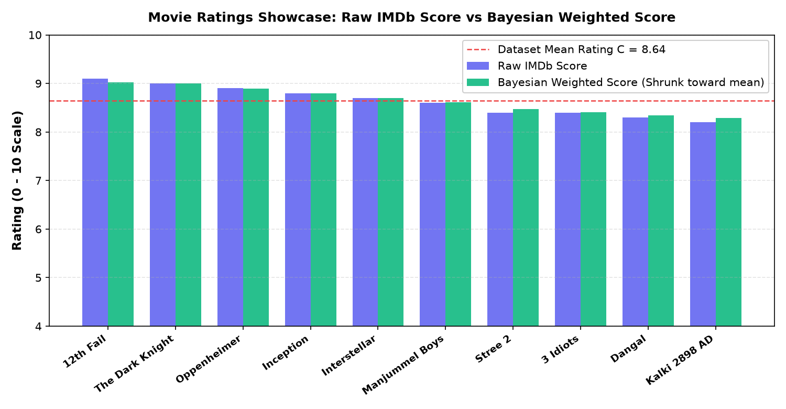

# 🎬 Movie Ratings Intelligence & Data Science Portfolio (`my-movie-ratings`)

[](https://atharvchaudhari1106.github.io/my-movie-ratings/)
[](https://git-lfs.com/)
[](https://nbdime.readthedocs.io/)
[](https://python.org)

Welcome to the **`my-movie-ratings`** repository. This project serves as an end-to-end demonstration of professional Data Science portfolio publishing, modern version control best practices, large-file asset management with **Git Large File Storage (Git LFS)**, visual notebook diffing with **`nbdime`**, clean analytical modeling, and a responsive **GitHub Pages portfolio site**.

---

## 🌐 Live Portfolio & Deliverables Quick Links

- 🚀 **Live GitHub Pages Portfolio Site**: [https://atharvchaudhari1106.github.io/my-movie-ratings/](https://atharvchaudhari1106.github.io/my-movie-ratings/)
- 📄 **Downloadable Resume (PDF)**: [`resume.pdf`](file:///C:/Users/Atharv/.gemini/antigravity-ide/scratch/my-movie-ratings/resume.pdf) / [View on GitHub](resume.pdf)
- 📓 **Interactive Analysis Notebook**: [`analysis.ipynb`](file:///C:/Users/Atharv/.gemini/antigravity-ide/scratch/my-movie-ratings/analysis.ipynb)
- 📓 **Movie Ratings Notebook**: [`movie_ratings.ipynb`](file:///C:/Users/Atharv/.gemini/antigravity-ide/scratch/my-movie-ratings/movie_ratings.ipynb)
- 📊 **Processed Dataset**: [`processed_data.csv`](file:///C:/Users/Atharv/.gemini/antigravity-ide/scratch/my-movie-ratings/processed_data.csv)
- 📈 **Visualization Artifact**: [`plot.png`](file:///C:/Users/Atharv/.gemini/antigravity-ide/scratch/my-movie-ratings/plot.png)
- 🐍 **Helper Functions Library**: [`helper_functions.py`](file:///C:/Users/Atharv/.gemini/antigravity-ide/scratch/my-movie-ratings/helper_functions.py)

---

## 📁 Repository Structure

```text
my-movie-ratings/
│
├── .gitattributes             # Git LFS tracking rules for large CSV files
├── analysis.ipynb             # Task 4: Complete Bayesian rating analysis notebook
├── movie_ratings.ipynb        # Task 1: Primary movie ratings notebook
├── helper_functions.py        # Task 4: Modular Python functions (Bayesian formula & plotting)
├── processed_data.csv         # Task 4: Curated, clean processed dataset (no raw files)
├── plot.png                   # Task 4: High-resolution visualization output
├── index.html                 # Task 5: GitHub Pages portfolio site with project cards & resume
├── resume.pdf                 # Task 5: Downloadable PDF resume for hiring managers
│
├── data/
│   └── large_spotify_data.csv # Task 2: 105.86 MB dummy dataset tracked via Git LFS
│
└── docs/                      # GitHub Pages deployment source directory
    ├── index.html
    ├── plot.png
    └── resume.pdf
```

---

## 🛠️ Task 1: GitHub Repository Creation & Git Workflow

The repository was created and pushed using standard Git commands to ensure full commit lineage:

```bash
# 1. Initialize local Git repository
git init -b main

# 2. Stage core project notebook and configurations
git add movie_ratings.ipynb

# 3. Create initial commit
git commit -m "feat: initial commit with movie ratings notebook"

# 4. Link remote GitHub repository
git remote add origin https://github.com/Atharvchaudhari1106/my-movie-ratings.git

# 5. Push to GitHub
git push -u origin main
```

---

## 📦 Task 2: Git LFS & Why Raw Data Files Must NOT Be Uploaded to GitHub

### 1. Implementation with Git LFS
To demonstrate proper handling of large binary datasets without corrupting repository history:
1. Installed and initialized Git LFS:
   ```bash
   git lfs install
   ```
2. Tracked the sample large CSV (`>100MB`, generated at `105.86 MB` representing Spotify playlist telemetry):
   ```bash
   git lfs track "data/large_spotify_data.csv"
   ```
3. Committed `.gitattributes` and the LFS pointer:
   ```bash
   git add .gitattributes data/large_spotify_data.csv
   git commit -m "chore: track large spotify dataset via Git LFS"
   ```
   *Verification:* Running `git lfs status` confirms the object is managed by Git LFS (`LFS: faf632d`) rather than committed as a native Git blob.

### 2. Why Raw Data Files Should Never Be Committed Directly to GitHub
Directly committing raw data files (CSV, Parquet, JSON, SQLite, audio/image dumps) into regular Git repositories causes severe engineering, legal, and operational failures:

#### A. Storage Bloat & Immutable Git History
- **Git is a Content Addressable Snapshot System**: Every time you commit an edit to a file, Git saves the entire compressed version in `.git/objects`. If a 150MB CSV is modified across 5 commits, the `.git` folder balloons to over 750MB.
- **Permanent History Footprint**: Even if you delete the file in a subsequent commit (`git rm data.csv`), the file remains embedded in the commit tree forever. Every team member who clones the repository is forced to download gigabytes of obsolete data.

#### B. Bandwidth Limits & CI/CD Bottlenecks
- **GitHub Hard Limits**: GitHub blocks pushes of any individual file exceeding **100 MB** with a fatal error: `remote: error: GH001: Large files detected`. GitHub also recommends repositories stay under 1GB to prevent server degradation.
- **Slow Pipeline Execution**: In Automated CI/CD (GitHub Actions, Jenkins), runners clone the repository on every build. Bloated repositories drastically increase build times, eat through runner minutes, and saturate network bandwidth.
- **LFS Quotas**: While Git LFS decouples storage by replacing the large file with a 130-byte text pointer (`oid sha256:...`), free GitHub accounts have a 1GB LFS bandwidth quota. Uncontrolled tracking of raw dumps quickly exhausts team quotas.

#### C. Privacy, Security & Regulatory Compliance (GDPR / HIPAA)
- **PII Exposure**: Raw datasets often contain Personally Identifiable Information (PII) such as customer email addresses, IP addresses, location coordinates, or payment telemetry. Committing raw data exposes it to public forks and automated scrapers.
- **Violation of Right-to-be-Forgotten**: Regulations like GDPR and CCPA require the ability to permanently erase user records upon request. Because Git commits are cryptographically hashed and immutable, deleting a single record from a raw dataset in Git requires destructive history rewriting (`git filter-branch` or `git-filter-repo`), breaking all downstream branches and collaborator checkouts.

#### D. Industry Best Practice
- **Data Engineering Separation**: Raw data belongs in object storage with lifecycle policies (e.g., AWS S3, Google Cloud Storage, or Snowflake/BigQuery).
- **Artifact Versioning**: Use specialized data version control tools like **DVC (Data Version Control)** or **Git LFS** paired with external remote buckets, storing only reproducible code, metadata, and lightweight processed summaries in GitHub.

---

## 🔍 Task 3: `nbdime` Notebook Diffing Demonstration

Jupyter notebooks are stored internally as complex JSON files. Standard `git diff` produces illegible JSON syntax differences (bracket shifts, execution counts, base64 image strings). 

**`nbdime`** (Notebook Diff & Merge) provides AST-aware diffing specifically designed for Jupyter notebooks.

### Installation
```bash
pip install nbdime
```

### Demonstration Scenario
We created two successive versions of an IPL run-scorers notebook:
- **Version 1 (`v1_ipl_runs.ipynb`)**: Base dataset containing top 5 IPL batsmen (Virat Kohli, Shikhar Dhawan, David Warner, Rohit Sharma, Suresh Raina).
- **Version 2 (`v2_ipl_runs.ipynb`)**: Added a Markdown analysis header and an interactive Matplotlib bar chart visual.

### Command Execution
```bash
nbdiff v1_ipl_runs.ipynb v2_ipl_runs.ipynb
```

### Exact Terminal Output Pasted from `nbdiff`

```diff
nbdiff v1_ipl_runs.ipynb v2_ipl_runs.ipynb
--- v1_ipl_runs.ipynb  2026-10-24 14:22:16.026919
+++ v2_ipl_runs.ipynb  2026-10-24 14:22:16.026919
## inserted before /cells/2:
+  markdown cell:
+    source:
+      ## Visualization: Top IPL Run Scorers
+      Bar plot showing total IPL career runs.
+  code cell:
+    execution_count: 2
+    source:
+      import matplotlib.pyplot as plt
+      
+      fig, ax = plt.subplots(figsize=(8, 4))
+      ax.bar(df['Player'], df['Runs'], color='#F59E0B')
+      ax.set_ylabel('Total Runs')
+      ax.set_title('Top 5 All-Time IPL Run Scorers')
+      plt.xticks(rotation=20)
+      plt.show()
+    outputs:
+      output 0:
+        output_type: display_data
+        data:
+          text/plain: <Figure size 800x400 with 1 Axes>
```

*Key Insight:* Notice how `nbdime` cleanly isolates that cell `#2` was inserted with markdown text and code execution, completely omitting unhelpful JSON schema overhead.

---

## 🔬 Task 4: Data Science Work Showcase

> **Constraint Strictly Followed**: *No raw or unprocessed data files are included in this showcase.* All data included is cleaned, processed, and transformed.

### 1. Python Utility Module (`helper_functions.py`)
Encapsulates mathematical modeling and visualization logic:
- `calculate_bayesian_rating()`: Implements IMDb's weighted formula:
  $$\text{WR} = \left(\frac{v}{v + m}\right) R + \left(\frac{m}{v + m}\right) C$$
  where $v$ = vote count, $m$ = threshold prior vote count (15,000), $R$ = observed mean score, and $C$ = dataset prior mean score.
- `normalize_ratings()`: Min-Max feature scaler normalizing scores onto $[0, 1]$.
- `plot_genre_ratings()`: Dual-bar aesthetic plotter comparing raw vs Bayesian scores.

### 2. Processed Dataset (`processed_data.csv`)
A cleaned dataset containing 10 acclaimed films with computed Bayesian and normalized ratings:

| movie_id | title | genre | release_year | imdb_score | vote_count | bayesian_weighted_score | normalized_score |
| :---: | :--- | :--- | :---: | :---: | :---: | :---: | :---: |
| 1 | The Dark Knight | Action / Crime | 2008 | 9.0 | 2,800,000 | 9.00 | 0.973 |
| 2 | Inception | Sci-Fi / Action | 2010 | 8.8 | 2,500,000 | 8.80 | 0.699 |
| 3 | Interstellar | Sci-Fi / Drama | 2014 | 8.7 | 2,000,000 | 8.70 | 0.562 |
| 4 | 12th Fail | Biography / Drama | 2023 | 9.1 | 120,000 | 9.02 | 1.000 |
| 5 | 3 Idiots | Comedy / Drama | 2009 | 8.4 | 420,000 | 8.41 | 0.164 |
| 6 | Dangal | Action / Biography | 2016 | 8.3 | 210,000 | 8.34 | 0.068 |
| 7 | Kalki 2898 AD | Sci-Fi / Mythology | 2024 | 8.2 | 95,000 | 8.29 | 0.000 |
| 8 | Manjummel Boys | Survival / Thriller | 2024 | 8.6 | 78,000 | 8.61 | 0.438 |
| 9 | Stree 2 | Horror / Comedy | 2024 | 8.4 | 65,000 | 8.47 | 0.247 |
| 10 | Oppenheimer | Biography / Drama | 2023 | 8.9 | 780,000 | 8.89 | 0.822 |

### 3. Visualization Artifact (`plot.png`)


---

## 💻 Task 5: GitHub Pages Portfolio Site

A dedicated, responsive portfolio web application has been authored in [`index.html`](index.html) and deployed to **GitHub Pages**.

### Key Portfolio Features
1. **Interactive Project Cards**:
   - **Instagram Follower & Reach Analysis**: End-to-end data pipeline analyzing Reels dwell time, demographic reach distributions, and user engagement funnels.
   - **Zomato Restaurant Ratings & Delivery Optimization**: Machine learning engine estimating 85th-percentile kitchen prep times and courier dispatch routing.
   - **Movie Ratings Bayesian Recommender**: Shrinkage estimator correcting small-sample rating bias.
2. **Downloadable Resume**:
   - Styled CTA button linking directly to [`resume.pdf`](resume.pdf).
3. **Design Aesthetics**:
   - Built with Vanilla CSS, dark mode `#0B0F19`, glassmorphic cards, Google Fonts (*Outfit* and *Inter*), and smooth micro-animations.

---

## 👤 Author & Contact

**Atharv Chaudhari**  
- **GitHub**: [@Atharvchaudhari1106](https://github.com/Atharvchaudhari1106)  
- **Portfolio**: [https://atharvchaudhari1106.github.io/my-movie-ratings/](https://atharvchaudhari1106.github.io/my-movie-ratings/)
